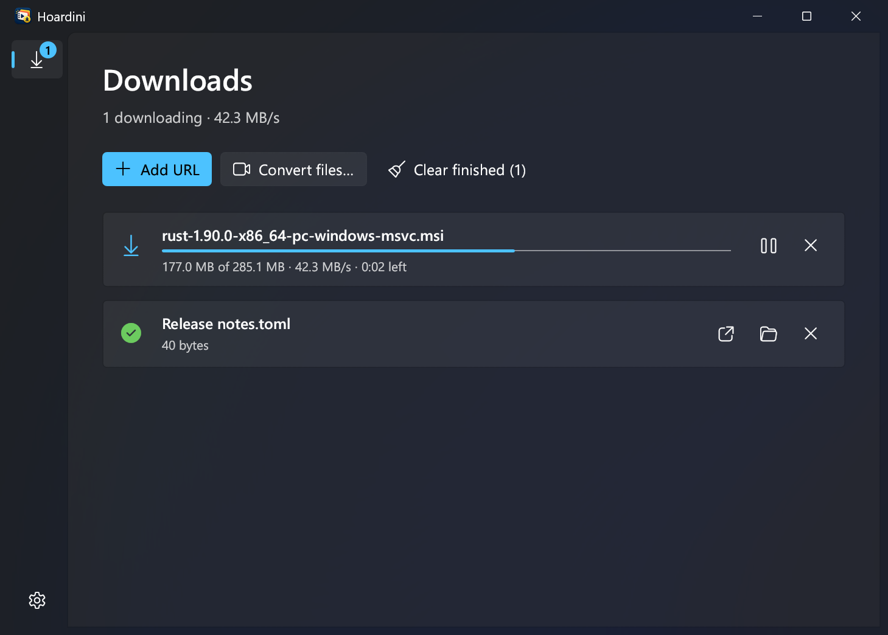
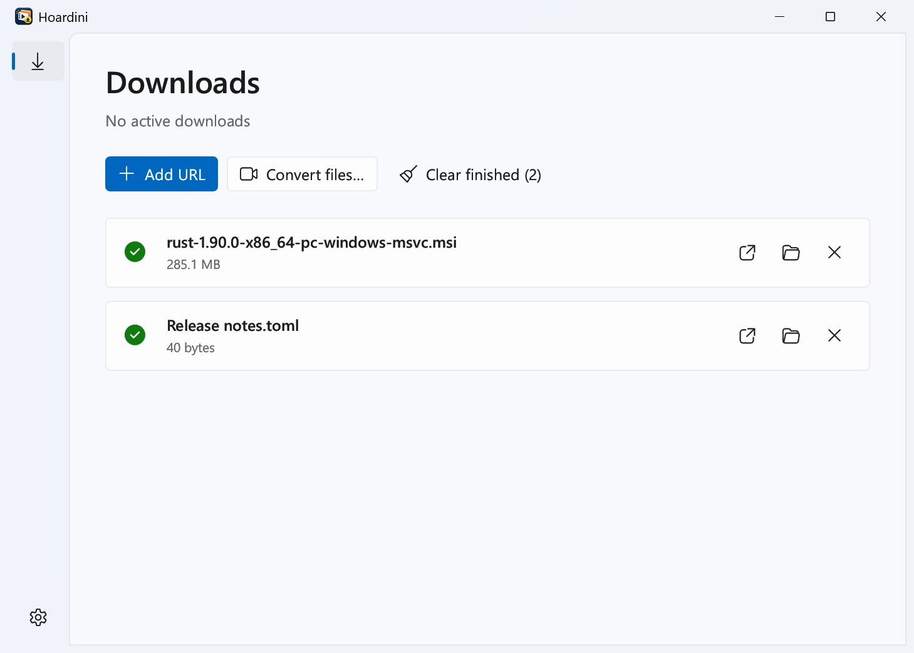

<p align="center">
  
</p>

<h1 align="center">Hoardini for Windows</h1>

<p align="center">
  A fast, free download manager for Windows 10 and 11.<br>
  Faster downloads, pause and resume, video saving, and a browser extension that hands downloads over to it.
</p>

<p align="center">
  <a href="https://github.com/raisv3n/hoardini-rs/releases/latest"></a>
  <a href="https://github.com/raisv3n/hoardini-rs/actions/workflows/ci.yml"></a>
  <a href="LICENSE"></a>
</p>

<p align="center">
  
  
</p>

## What it does

- **Faster downloads.** Each file is split into up to 8 parts that download at the same time.
- **Pause and resume.** Pause a download, close the app, or lose your connection: it continues where it stopped.
  This works for streamed videos too.
- **Save videos.** Detects videos playing on a web page (including HLS `.m3u8` streams such as Vimeo and Tella, and
  Facebook videos in your choice of quality) and saves them as one MP4 without any loss of quality.
- **Works with your browser.** With the extension installed, Chrome, Edge and Brave hand their downloads to Hoardini
  automatically, and links, videos and images get a **Download with Hoardini** right-click option.
- **Stays out of the way.** Closing the window keeps downloads running in the system tray.
- **Looks like Windows 11.** Follows your light/dark mode and accent color, or pick a theme in Settings.

It's free and open source, needs no account, and everything runs on your PC.

## Download and install

**[⬇ Download the latest version](https://github.com/raisv3n/hoardini-rs/releases/latest)**: under
**Assets**, click `Hoardini-<version>-windows-x64.zip`.

1. **Extract the zip.** Right-click the downloaded file → **Extract All…** → **Extract**.
   (Don't run the installer from inside the zip without extracting it first.)

2. **Run the installer.** In the extracted folder, double-click **`install.cmd`**.
   - If Windows shows **"Windows protected your PC"**, click **More info** → **Run anyway**.
     Hoardini isn't code-signed (that costs money), so Windows doesn't recognize it yet.
   - It installs for your account only. No administrator rights are needed.
   - When it asks **"Install ffmpeg now with winget? [Y/n]"**, press **Enter**. ffmpeg is a free tool
     that Hoardini uses to convert videos to MP4. You can skip it and install it later from the app.

3. **Add the browser extension.** This lets your browser send downloads to Hoardini.
   1. Open your browser's extensions page: type `chrome://extensions` in Chrome,
      `edge://extensions` in Edge or `brave://extensions` in Brave, then press Enter.
   2. Turn on **Developer mode** (top right in Chrome and Brave, left sidebar in Edge).
   3. Click **Load unpacked**.
   4. In the folder picker, click the address bar, press **Ctrl+V** (the installer copied
      `%LOCALAPPDATA%\Hoardini\extension` to the clipboard), press Enter, then click **Select Folder**.
      **Don't pick the `extension` folder inside the extracted download**: the browser keeps loading the
      extension from the folder you choose, so it would stop working once you delete the download.
   5. Optional: click the puzzle-piece icon in the toolbar and pin **Hoardini**.

That's it. Open **Hoardini** from the Start menu, or just download something in your browser.
After installing, you can delete the zip and the extracted folder.

> **Why "Developer mode"?** The extension isn't in the Chrome Web Store, so browsers only allow it in
> Developer mode. Browsers sometimes show a reminder about extensions installed this way; that's expected.

## Using Hoardini

| To… | Do this |
|---|---|
| Download a file | Download it in your browser as usual: Hoardini takes over. Or click **Add URL** in the app (Ctrl+N) and paste a link. |
| Save a video from a web page | Play the video, then click the Hoardini toolbar icon. Pick a quality, adjust the file name, and click **Download**. |
| Download a specific link or image | Right-click it → **Download with Hoardini**. |
| Save a Facebook video | Open the video and click the Hoardini toolbar icon. Pick a quality (720p, 360p… or the HD/SD file) and click **Download**. If the popup asks you to, reload the page first. |
| Pause, resume, retry, cancel | Use the buttons on each download, or right-click it for more options. Quitting pauses running downloads; resume them next time. |
| Open a finished file | Double-click it, or use the play/open and folder buttons. Files go to your **Downloads** folder. |
| Convert videos to MP4 | MPEG-TS videos (`.ts`, `.mts`, `.m2ts`) are converted automatically after downloading (can be turned off in **Settings**). For files you already have, click **Convert files…** (Ctrl+O). |
| Let the browser handle downloads again | Click the Hoardini toolbar icon and turn off **Capture browser downloads**. |
| Change the theme | **Settings** (gear icon, bottom left) → **App theme**: Light, Dark or Use system setting. |
| Quit completely | Right-click the Hoardini icon in the system tray → **Quit Hoardini**. Closing the window only hides it. |

## Troubleshooting

<details>
<summary><b>"Windows protected your PC" when running the installer or the app</b></summary>

Click **More info** → **Run anyway**. This appears because Hoardini isn't code-signed. The source code is all
here, and the release files are built from it by GitHub Actions. Each release also includes a `.sha256` file to check the download.
</details>

<details>
<summary><b>The extension's Download button says "Failed", or browser downloads aren't handed over</b></summary>

1. Make sure Hoardini is installed: run `install.cmd` again. It's safe to repeat.
2. On the browser's extensions page, click the **reload** icon on the Hoardini card.
3. Fully close the browser (all windows) and open it again.
4. Check that **Capture browser downloads** is on in the extension's popup.

If the extension can't reach Hoardini, the browser still downloads the file itself, so nothing is lost.
</details>

<details>
<summary><b>The extension stopped working after I deleted the download</b></summary>

It was loaded from the folder inside the download. On the extensions page, click **Remove** on the Hoardini card,
then **Load unpacked** again and choose `%LOCALAPPDATA%\Hoardini\extension`. If that folder is missing, run
`install.cmd` from a fresh download first.
</details>

<details>
<summary><b>"ffmpeg isn't installed" or "Converts to MP4 once ffmpeg is installed"</b></summary>

Click **Install** in the notice at the top of the app (or in **Settings → ffmpeg**). Anything waiting for it
continues automatically once it's installed. If your PC has no winget, the button opens the ffmpeg download
page. You can also run `winget install Gyan.FFmpeg` in a terminal.
</details>

<details>
<summary><b>The video popup says "No media detected yet"</b></summary>

Start playing the video first, then open the popup again. Some sites aren't supported:
YouTube (its terms don't allow it), DRM-protected streams (Netflix, Disney+ and similar), and live streams.
</details>

<details>
<summary><b>My antivirus flagged a file</b></summary>

New, unsigned programs are sometimes flagged by mistake. You can check the release zip against its `.sha256`
file, or build Hoardini yourself from this repository (see below).
</details>

## Updating

Download the new zip, extract it, and run its `install.cmd`. Your downloads, list and settings are kept.
Then click the **reload** icon on the Hoardini card on your browser's extensions page.

## Uninstalling

Run `uninstall.cmd` from any release zip, and remove the extension from your browser.
Downloaded files are never touched. Your list and settings in `%APPDATA%\Hoardini` are kept in case you
reinstall; delete that folder to remove them too.

## Privacy

Hoardini runs entirely on your PC, with no accounts, analytics or telemetry. To download files that need you to be
signed in, the extension passes that site's cookies to Hoardini. They're only ever sent back to that same site,
and they're removed from the download list as soon as the download finishes. Downloaded files are tagged the
same way browsers tag them, so Windows still checks them with SmartScreen before they're opened.

---

## For developers

Hoardini for Windows is a Rust port of [Hoardini for macOS](https://github.com/raisv3n/Hoardini) (Swift).
The download engine, command-line tool and interface are cross-platform; a Linux version is planned in this
repository.

### Building from source

Requirements: Windows 10/11 x64, [Rust](https://rustup.rs) (MSVC toolchain) with the Visual Studio C++ Build
Tools, and optionally [ffmpeg](https://ffmpeg.org) (`winget install Gyan.FFmpeg`).

```powershell
.\scripts\install.ps1     # build in release mode and install for the current user
cargo test --workspace    # unit and integration tests
.\scripts\package.ps1     # build the release zip into dist\
```

`install.ps1` copies the three programs to `%LOCALAPPDATA%\Hoardini\bin`, copies the extension to
`%LOCALAPPDATA%\Hoardini\extension`, registers the native-messaging host for Chrome, Edge, Brave and
Chromium under `HKCU`, and adds a Start menu shortcut.

### Releasing

Bump `version` in the root `Cargo.toml`, then push a matching tag. The
[release workflow](.github/workflows/release.yml) tests, builds and publishes the zip and its SHA-256 checksum:

```powershell
git tag v0.5.7
git push origin v0.5.7
```

### Dependencies at runtime

| | Needed for | In the release |
|---|---|---|
| Windows 10/11 x64 | everything | required |
| ffmpeg | MP4 conversion, merging separate video and audio tracks (HLS, Facebook) | optional, not bundled (the usual builds are GPL); the installer and the app offer `winget install Gyan.FFmpeg` |
| Visual C++ runtime | — | not needed: the C runtime is linked statically (`.cargo/config.toml`) |

Hoardini looks for ffmpeg on `PATH`, next to `hoardini-app.exe` and in winget's links folder. `HOARDINI_FFMPEG`
overrides the search with an exact path.

### Command line

```
hoardini <url> [-o dir] [-n connections] [-H "Name: value"]... [--headers-stdin] [--name file] [--hls] [--variant url] [--audio url]
hoardini convert <file.ts>...
```

`--audio`: `<url>` is a video-only file; the audio-only file is downloaded alongside it and both are merged into
one MP4 (needs ffmpeg). Press Ctrl+C to pause. Running the same command again resumes from the saved state,
for files and HLS streams alike.

### Layout

| Crate | Swift original | What it is |
|---|---|---|
| `crates/hoardini-core` | `HoardiniCore` | probe, segment planner, downloader, HLS, remux |
| `crates/hoardini-cli` | `hoardini` | the `hoardini.exe` command |
| `crates/hoardini-host` | `hoardini-host` | browser native-messaging host |
| `crates/hoardini-app` | `HoardiniApp` | egui window (Fluent styling) + tray icon |
| `extension/` | `extension/` | the Chrome/Edge/Brave extension (unchanged from the original) |

Download behaviour follows the original's spec:
- **Probe:** a `GET` with `Range: bytes=0-0`.
- **Partial files:** a `<name>.part` file plus a `<name>.hoardini` JSON sidecar.
- **Resume:** only while the length and the ETag/Last-Modified still match.
- **Retries:** 3, with backoff.
- **HLS resume:** `<name>.hoardini` records, per track, the segment count, segments done, bytes written and the next
  fMP4 fragment number. A changed stream (source, variant or segment counts) starts over.
- **Split streams and pairs:** each track downloads to a hidden `.<name>.video.<ext>` / `.<name>.audio.<ext>` file
  next to the final name, then ffmpeg merges them. fMP4 fragments are renumbered as they are joined (Tella numbers
  every segment 1).

| macOS | Windows |
|---|---|
| `URLSession`, redirect guard | `reqwest` (drops Cookie/Authorization on cross-host redirects) |
| AVFoundation passthrough export | `ffmpeg -c copy` |
| Quarantine attribute (Gatekeeper) | Mark of the Web, `:Zone.Identifier` stream (SmartScreen) |
| `flock` on `<name>.lock` | exclusive, delete-on-close `<name>.lock` |
| SwiftUI + `MenuBarExtra` | egui with Mica and Fluent styling + system tray icon |
| `~/Library/Application Support/Hoardini` | `%APPDATA%\Hoardini` |
| `open -g -b com.hoardini.app` | named mutex `Local\Hoardini.App` + `hoardini-app.exe --background` |

## License

MIT. See [LICENSE](LICENSE).
